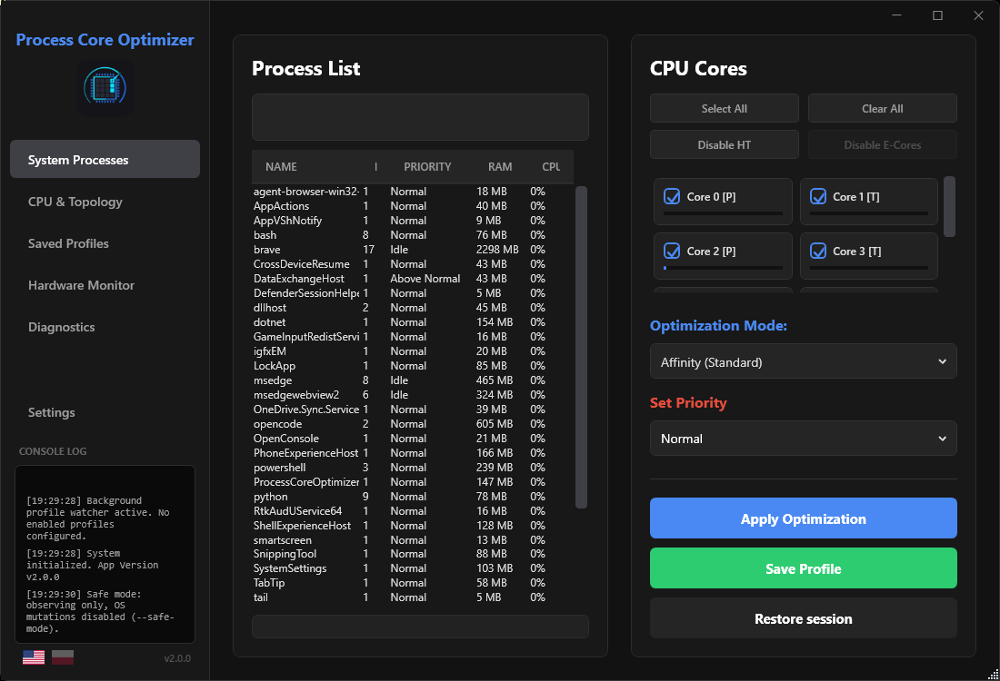
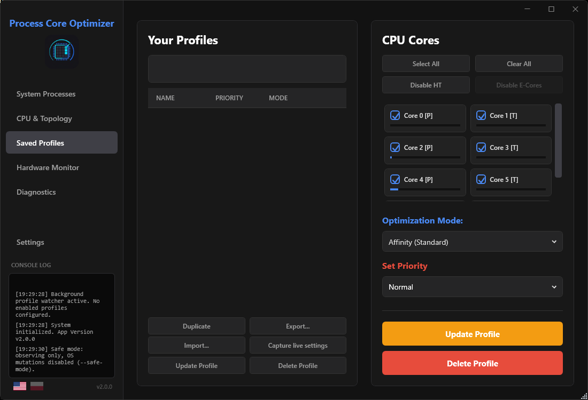
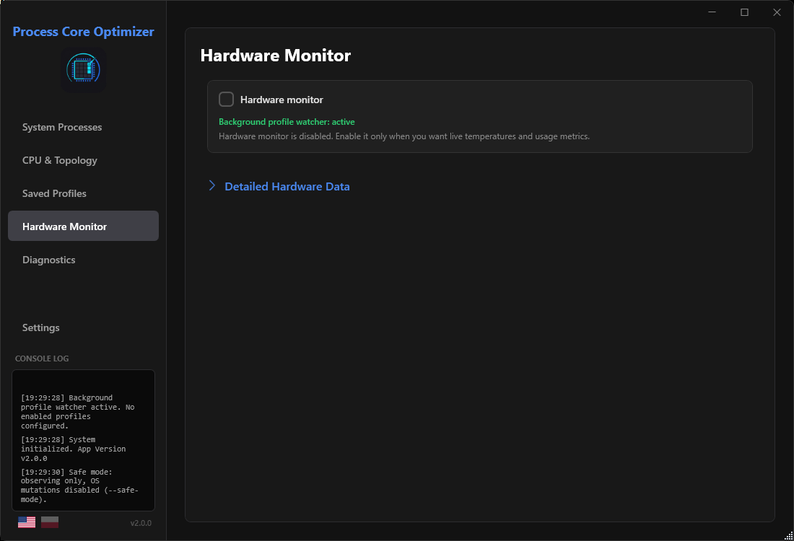
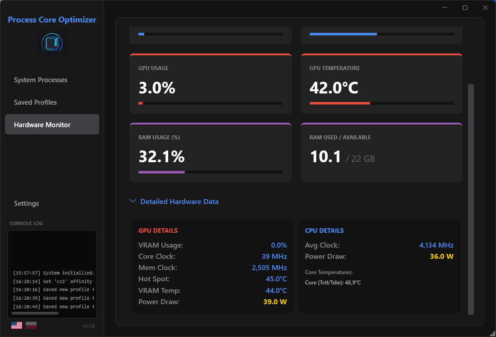

<h1 align="center">Process Core Optimizer</h1>

<p align="center">
  Advanced Windows process optimization utility for CPU affinity, CPU Sets, priority management, and process profiles.
</p>

<p align="center">
  
</p>

<p align="center">
  
  
  
  
  
</p>

---

**Process Core Optimizer** is a Windows utility for advanced users who want to manage process priority, classic CPU affinity, and Windows CPU Sets from a clean WPF interface.

The project is intended for experimentation, troubleshooting, and personal performance tuning. Performance gains are workload-dependent and are not guaranteed.

> Current version: **v1.3.0**  
> Platform: **Windows**  
> Status: **standalone utility**

---

## FrameHub

If you find Process Core Optimizer useful, I also invite you to test my newer project:

**FrameHub**  
https://github.com/9Erza/FrameHub

FrameHub includes the core process optimization functionality from Process Core Optimizer, but expands it into a broader Windows gaming performance hub.

It adds more features around game/app library management, saved optimization profiles, background process monitoring, Counter-Strike 2 configuration tools, backups, and other performance-focused modules.

Process Core Optimizer remains a focused standalone utility, while FrameHub is the larger project where this idea is being developed further.

---

## What Process Core Optimizer does

Process Core Optimizer is designed to give users direct control over selected process-level performance settings without hidden tweaks or black-box behavior.

Current core features:

- Process priority management
- Classic Windows CPU affinity management
- Windows CPU Sets support
- Saved optimization profiles
- Automatic profile application when a target process starts
- Lightweight background profile watcher
- P/E-core and SMT/HT awareness where supported
- Per-core selection tools
- Optional hardware telemetry
- English and Polish UI
- User settings, profiles, and logs stored in `%APPDATA%\ProcessCoreOptimizer`
- Atomic profile/settings saving with backup fallback
- Single-instance guard

---

## Optimization modes

Process Core Optimizer supports two optimization modes.

### Affinity

Affinity strictly binds selected processes to selected logical processors by using classic Windows process affinity.

This mode gives stronger control over where a process can run, but it can also be more restrictive.

### CPU Sets

CPU Sets use documented Windows CPU Sets as a softer scheduling hint.

This is usually safer than hard affinity for modern Windows scheduling because it gives Windows more flexibility while still guiding process placement.

### Removed Exclusive mode

The previous **Exclusive** mode has been removed.

Moving unrelated background processes away from selected cores can reduce system stability and is not worth the risk for a normal desktop utility.

Old profiles containing `Exclusive` are automatically migrated to `Affinity`.

---

## Key features

### Persistent profiles

Save CPU affinity, CPU Sets, and priority settings per process name.

Profiles can be applied automatically when the selected process starts.

### Lightweight profile watcher

The background watcher monitors only enabled profile process names instead of constantly scanning the entire process table.

This keeps background monitoring lightweight.

### Priority management

Process priority can be changed from Idle to High.

RealTime priority is hidden by default and must be explicitly enabled in settings because it can make the system unstable or unresponsive.

### P/E-core awareness

Where supported, Process Core Optimizer uses Windows CPU Sets topology data to label:

- Performance cores
- Efficiency cores
- SMT / Hyper-Threading threads

This helps users make more informed CPU selection decisions on modern processors.

### Per-core selection

The application includes quick CPU selection actions:

- select all cores
- clear all cores
- disable SMT / HT threads
- disable E-cores

### On-demand hardware telemetry

CPU, GPU, and RAM metrics are provided through LibreHardwareMonitor.

Hardware telemetry is initialized only when the Hardware tab is opened.

### User-data safe storage

Profiles, settings, and logs are stored under:

```text
%APPDATA%\ProcessCoreOptimizer
```

This keeps user data separate from the application directory.

---

## Important limitations

Process Core Optimizer is a low-level system utility, so some limitations are expected.

- The UI currently targets the first Windows processor group / first 64 logical processors.
- Very large workstation CPUs may require future multi-group support.
- Some protected processes or games may reject external priority, affinity, or CPU Set changes.
- Compatibility with anti-cheat systems is not guaranteed.
- RealTime priority can make the system unresponsive and is disabled unless explicitly enabled in settings.

Use with online games at your own risk.

---

## Data files

Process Core Optimizer stores user data here:

```text
%APPDATA%\ProcessCoreOptimizer\settings.json
%APPDATA%\ProcessCoreOptimizer\profiles.json
%APPDATA%\ProcessCoreOptimizer\ProcessCoreOptimizer.log
```

If older versions stored `settings.json` or `profiles.json` next to the `.exe`, Process Core Optimizer migrates them automatically on first launch.

---

## Screenshots

<details>
  <summary><b>Click to expand / hide gallery</b></summary>
  <br>
  <table align="center">
    <tr>
      <td align="center" width="50%">
        <b>System Processes</b><br>
        
      </td>
      <td align="center" width="50%">
        <b>Profiles Manager</b><br>
        
      </td>
    </tr>
    <tr>
      <td align="center">
        <b>Hardware Monitor</b><br>
        
      </td>
      <td align="center">
        <b>Detailed Telemetry</b><br>
        
      </td>
    </tr>
  </table>
</details>

---

## v1.3.0 focus

Version 1.3.0 focuses on making Process Core Optimizer a more stable foundation for future development.

This version introduces:

- separated process scanning
- central optimization service
- lazy hardware monitoring
- atomic JSON persistence
- log rotation
- startup argument parsing

See `CHANGELOG.md` for details.

---

## Safety notice

Process Core Optimizer changes process-level Windows settings.

The application does not guarantee performance improvements, and incorrect settings may reduce stability or cause unexpected behavior in specific applications.

Before applying profiles to games, productivity software, or protected processes, make sure you understand what the selected mode does.

RealTime priority should be used with extreme caution.

---

## Anti-cheat notice

Compatibility with anti-cheat systems is not guaranteed.

Some games may block or reject external changes to priority, affinity, or CPU Sets. Process Core Optimizer does not attempt to bypass these restrictions.

Use with online games at your own risk.

For a broader and more conservative gaming-focused workflow, you can also test FrameHub:

https://github.com/9Erza/FrameHub

---

## Build

Open the solution in Visual Studio Community and run:

```text
Build > Rebuild Solution
```

The project targets Windows WPF on .NET.

---

## Tech stack

- C#
- WPF
- Windows CPU Sets API
- LibreHardwareMonitor

---

## Author

Developed by **[Eryk / 9Erza](https://github.com/9Erza)**.

---

## License

MIT License. See [LICENSE](LICENSE).
