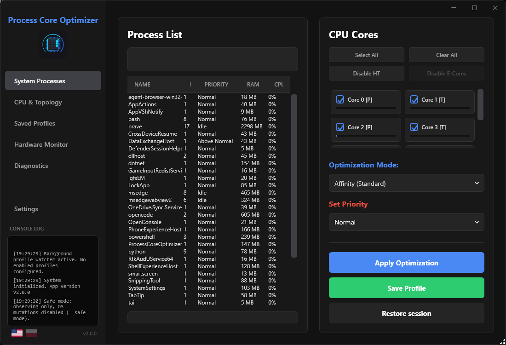
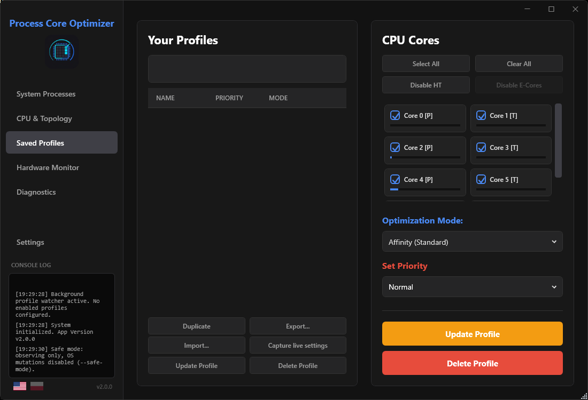
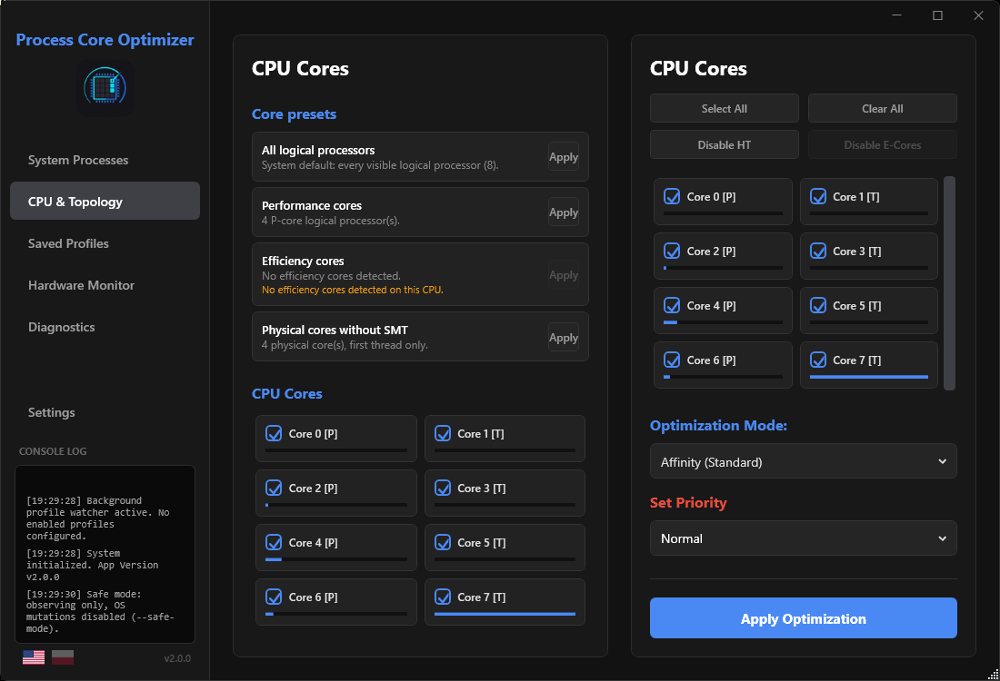
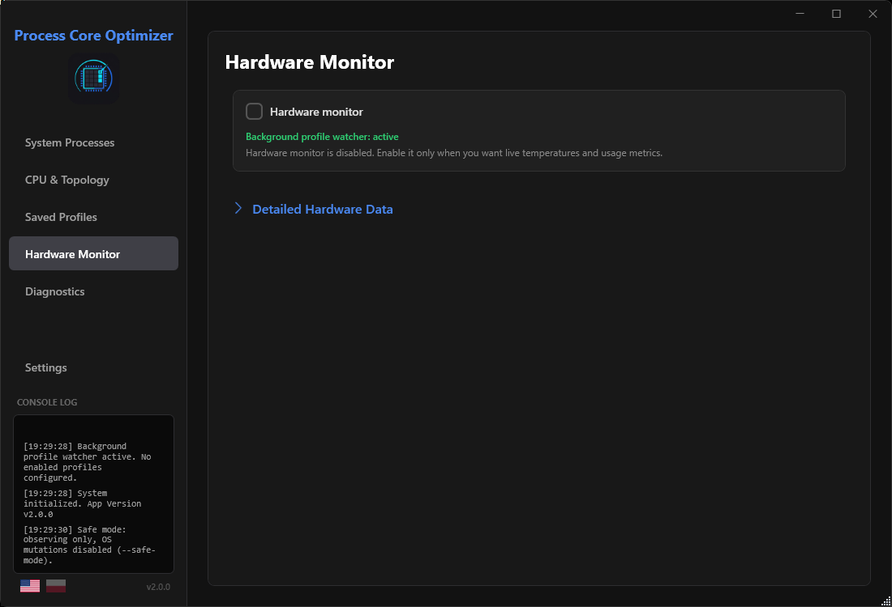
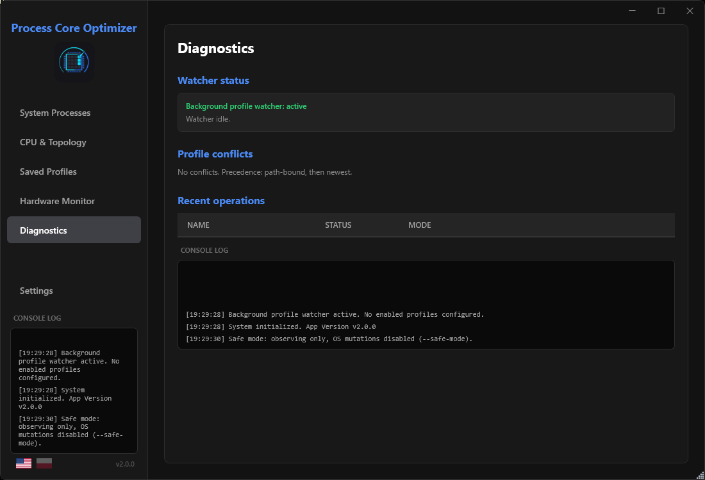
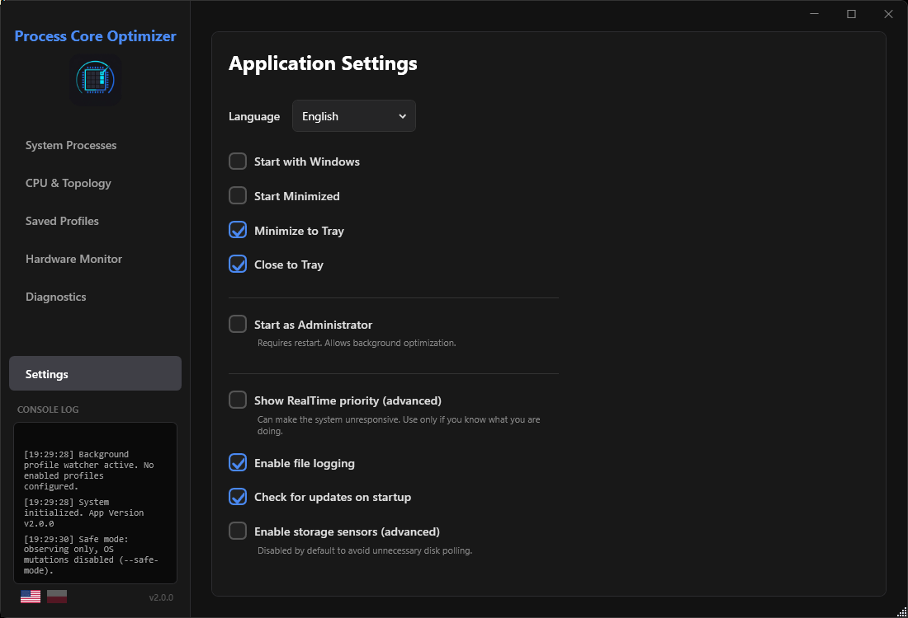

<div align="center">


# Process Core Optimizer

**Bezpośrednie zarządzanie procesami i CPU w Windows — affinity, CPU Sets, priorytety i profile.**

[**English**](README.md) · [**Polski**](README.pl.md)


[](https://github.com/9Erza/ProcessCoreOptimizer/actions/workflows/ci.yml)
[](LICENSE)


</div>

> [!NOTE]
> **Ostatnie publiczne wydanie: v1.3.0** ([GitHub Releases](https://github.com/9Erza/ProcessCoreOptimizer/releases)).
> **v2.0.0 to kandydat do wydania (release candidate)** w finalnym przeglądzie — nieopublikowany.
> Lekkie, samodzielne narzędzie do zarządzania CPU procesów.
> Bez ukrytych optymalizacji i zbędnego obciążenia — każda zmiana jest jawna, odwracalna i logowana.

## Co nowego w 2.0

- **Silnik 2.0:** mutacje z bramką tożsamości (PID + czas startu + nazwa + ścieżka),
  brak ścieżek PID-only, jawne wyniki operacji
  (`FullyApplied` / `PartiallyApplied` / `Failed` / pominięcia), walidacja masek,
  uczciwa semantyka Affinity vs CPU Sets.
- **Profile 2.0:** deterministyczne wykrywanie konfliktów (path-bound wygrywa),
  duplikowanie / import / eksport, szkice z bieżących ustawień, historia operacji,
  watcher jako wydzielony serwis.
- **Zakładka CPU i topologia:** uczciwy stan Unknown, nazwane presety rdzeni,
  wykrywanie wielu grup, ścieżki EXE w snapshotach, szczegóły procesów, filtry.
- **Zakładka Diagnostyka:** status watchera, ostatnie operacje, konflikty, aktywność reguł, eksport ZIP, log.
- **Process Explorer 2.0:** widoki Grupy / pojedyncze instancje PID, sortowanie numeryczne,
  filtry po ścieżce, uczciwe szczegóły (Unknown), lekkie wykresy CPU/RAM,
  menu kontekstowe, zastosowanie do jednej instancji.
- **Profile Studio:** pełny edytor (nazwa, ścieżka EXE, affinity, priorytet, CPU Sets,
  EcoQoS trójstanowy) z walidacją; update/delete po stabilnym Id.
- **Inteligentne reguły:** wyzwalacze uruchomienia + aktywnego okna (debounce),
  cooldowny, priorytety, globalna pauza, wytłumaczalny feed aktywności.
- **EcoQoS:** jawne wł./wył. na profil przez oficjalne API Windows (nigdy automatycznie).
- **Niezawodność:** przywracanie ustawień sprzed optymalizacji, aktualizator
  powiadamiający tylko o opublikowanych wydaniach z assetem instalatora,
  rejestracja autostartu tylko przy zmianie ustawień startu, centralne wersjonowanie `version.txt`.
- **Testy:** 231 zaliczonych + 3 warunkowe testy integracyjne, zielone CI (build + testy + `git diff --check`).

Zobacz [CHANGELOG.md](CHANGELOG.md), [docs/ARCHITECTURE.md](docs/ARCHITECTURE.md)
i [docs/RELEASE_NOTES_2.0.0.pl.md](docs/RELEASE_NOTES_2.0.0.pl.md).

## Czym jest Process Core Optimizer?

**Process Core Optimizer (PCO)** to lekkie narzędzie dla zaawansowanych użytkowników,
którzy chcą bezpośrednio kontrolować wykorzystanie CPU przez procesy.

Zamiast nieprzejrzystych „przyspieszaczy”, PCO daje jawną kontrolę nad:

- **który proces** jest zmieniany,
- **których rdzeni** może używać,
- **z jakim priorytetem** działa,
- **kiedy** ustawienie jest stosowane (ręcznie lub automatycznie przez profile).

PCO był pierwotnym projektem, a jego silnik dojrzewał równolegle z pracami nad [FrameHub](#framehub) —
pozostając jednak osobnym, wyspecjalizowanym narzędziem bez gamingowego nadmiaru funkcji.

Typowe zastosowania:

- przypięcie gry lub renderera do rdzeni P, a aplikacji tła do rdzeni E;
- obniżenie priorytetu launcherów, updaterów i nakładek;
- testowanie różnic affinity vs CPU Sets na Intel Hybrid lub AMD SMT;
- trwałe ustawienia per-proces dzięki profilom stosowanym automatycznie.

Wzrost wydajności zależy od obciążenia i **nie jest gwarantowany**.

---

## Funkcje

- **Zarządzanie priorytetami** — od Idle do High; RealTime ukryty za wyraźną zgodą.
- **Klasyczne affinity CPU** — twarde wiązanie przez `ProcessorAffinity`.
- **Windows CPU Sets** — miękka wskazówka szeregowania przez `SetProcessDefaultCpuSets`.
- **Zapisane profile** — presety Affinity / CPU Sets / priorytetu per-proces (opcjonalnie przypięte do ścieżki EXE).
- **Automatyczny watcher** — lekka pętla w tle stosuje włączone profile do nowo startujących procesów.
- **Bezpieczne mutacje** — PID + czas startu + nazwa procesu (+ ścieżka EXE dla profili path-bound) weryfikowane przed każdym zapisem do OS; zrecyklingowane PID-y są odrzucane, nie zgadywane; nie istnieją ścieżki mutacji PID-only.
- **Uczciwe wyniki operacji** — pełny vs częściowy vs nieudany vs pominięty, z semantyką retry; częściowy sukces nigdy nie jest cachowany jako wykonany.
- **Świadomość P/E-core i SMT** z uczciwym stanem Unknown przy braku danych z firmware oraz nazwanymi presetami rdzeni (All / P-cores / E-cores / physical-without-SMT), pokazywanymi tylko gdy poprawne.
- **Przywracanie sesji** — powrót do affinity/priorytetu sprzed optymalizacji jednym kliknięciem, z weryfikacją tożsamości instancji.
- **Szybkie narzędzia rdzeni** — zaznacz wszystkie, wyczyść, wyłącz wątki SMT/HT, wyłącz E-cores.
- **Opcjonalna telemetria** — CPU / GPU / RAM przez LibreHardwareMonitor, leniwa i domyślnie wyłączona.
- **Dwujęzyczny UI** — English / Polski, przełączany w aplikacji.
- **Bezpieczny zapis** — atomowy JSON (`tmp` + `File.Replace` + `.bak`) z powrotem do kopii przy uszkodzonym pliku.
- **Pojedyncza instancja** — mutex z obsługą awaryjnego przejęcia po crashu (`AbandonedMutex`).

---

## Affinity vs CPU Sets

PCO obsługuje dwa tryby CPU. To **nie** są synonimy.

| | **Affinity** | **CPU Sets** |
|---|---|---|
| Mechanizm OS | `ProcessorAffinity` — twarde wiązanie | `SetProcessDefaultCpuSets` — preferencja szeregowania |
| Siła | Proces może działać **tylko** na wybranych procesorach logicznych | Scheduler **preferuje** wybrane zbiory, ale może zdecydować inaczej pod obciążeniem |
| Czyści drugi mechanizm? | Tak — ustawienie Affinity czyści CPU Sets procesu | Nie — CPU Sets współistnieją z maską affinity |
| Do czego | Ścisła izolacja, powtarzalne testy przypięcia | Codzienne ukierunkowanie na CPU hybrydowych, mniej restrykcyjne |
| Ryzyko | Zbyt wąskie przypięcie może obniżyć przepustowość | Słabsza gwarancja, ale przyjaźniejsze dla scheduler-a Windows |

> [!IMPORTANT]
> Ograniczona maska affinity ogranicza też realny efekt CPU Sets dla tego procesu.
> PCO nigdy nie obiecuje, że CPU Sets ominie istniejące ograniczenie affinity.

Starsze profile `Exclusive` są automatycznie migrowane do `Affinity`.

---

## Profile i watcher

Profil celuje w **nazwę procesu** (np. `notepad`), opcjonalnie przypięty do **dokładnej ścieżki EXE**
(np. `C:\Apps\editor\app.exe`). Profile path-bound nigdy nie obejmują innego pliku o tej samej nazwie —
inna ścieżka to **brak dopasowania, brak mutacji**.

Każdy profil niezależnie przełącza:

- `ApplyCoreOptimization` (Affinity / CPU Sets + maska),
- `ApplyPriority` (wartość priorytetu).

Profile tylko-priorytetowe (maska `0`) są poprawne i zachowywane. Profile rdzeniowe wymagają niezerowej maski.

Watcher w tle:

1. skanuje **tylko** nazwy włączonych profili (`GetProcessesByName`, bez pełnego skanu tabeli),
2. weryfikuje tożsamość każdej instancji (PID + czas startu + nazwa + ścieżka),
3. stosuje najlepsze dopasowanie (profil ze ścieżką wygrywa z nazwowym),
4. cachuje **tylko w pełni zastosowane** sygnatury — częściowe porażki są ponawiane w kolejnym ticku,
5. ogranicza logi błędów (60 s na przyczynę, limitowany cache).

Ręczne akcje **Apply / Save / Update** używają `force: true` i omijają cache.

---

## Topologia CPU i ograniczenia

- Topologia z `GetSystemCpuSetInformation` (grupa 0) z awaryjnym fallbackiem WMI.
- Rdzenie etykietowane `[P]` performance, `[T]` wątek SMT/HT, `[E]` efficiency, gdy firmware udostępnia klasy efektywności.
- **Aktualny limit UI: grupa procesorów 0 / pierwsze 64 procesory logiczne.** Klasyczne maski affinity są 64-bitowe; większe workstationy są wykrywane i uczciwie logowane, zamiast udawać pełne wsparcie.
- Układy AMD SMT i Intel Hybrid (P/E) przechodzą tę samą ścieżkę topologii; bez danych o efektywności stosowana jest zachowawcza heurystyka.

---

## Wymagania

- Windows 10 / 11 x64
- .NET 10 Desktop Runtime (WPF)
- Bez sterownika, usługi i komponentu kernel. Bez wstrzykiwania kodu i odczytu pamięci procesów.
- Część operacji (priorytet/affinity na procesach elevated lub chronionych) wymaga uruchomienia PCO jako administrator; w przeciwnym razie OS odmawia, a PCO raportuje błąd zamiast go omijać.

---

## Instalacja i uruchomienie

> **Status wydania:** aktualne publiczne wydanie to **v1.3.0**. Poniższy **v2.0.0**
> to kandydat do wydania oczekujący na ręczny odbiór — nie traktuj tej gałęzi jako opublikowanego release.

1. Otwórz [GitHub Releases](https://github.com/9Erza/ProcessCoreOptimizer/releases) i pobierz najnowszy **opublikowany** build `ProcessCoreOptimizer` (v1.3.0).
2. Wypakuj i uruchom `ProcessCoreOptimizer.exe` na Windows 10/11 x64.
3. Opcjonalne flagi startu: `--minimized`, `--tray`, `--no-update-check`, `--safe-mode`.

Dane użytkownika **nigdy** nie leżą obok EXE. Wszystko jest tutaj:

```text
%APPDATA%\ProcessCoreOptimizer\settings.json
%APPDATA%\ProcessCoreOptimizer\profiles.json
%APPDATA%\ProcessCoreOptimizer\ProcessCoreOptimizer.log
```

Starsze pliki obok EXE są migrowane jednokierunkowo przy pierwszym starcie.

---

## Screenshots

<details>
  <summary><b>Kliknij, aby rozwinąć / zwinąć galerię</b></summary>
  <br>
  <table align="center">
    <tr>
      <td align="center" width="50%">
        <b>Procesy systemowe</b><br>
        
      </td>
      <td align="center" width="50%">
        <b>Menedżer profili</b><br>
        
      </td>
    </tr>
    <tr>
      <td align="center">
        <b>CPU i topologia</b><br>
        
      </td>
      <td align="center">
        <b>Monitor sprzętu</b><br>
        
      </td>
    </tr>
    <tr>
      <td align="center">
        <b>Diagnostyka</b><br>
        
      </td>
      <td align="center">
        <b>Ustawienia</b><br>
        
      </td>
    </tr>
  </table>
  <p align="center"><i>Zrzuty: prawdziwe UI PCO 2.0 z Windows 11 (1920×1080, 100% DPI). Bez mockupów.</i></p>
</details>

---

## Bezpieczeństwo i anti-cheat

PCO zmienia ustawienia procesów na poziomie Windows. Błędne ustawienia mogą obniżyć stabilność.

- Procesy systemowe (`svchost`, `lsass`, `csrss`, `dwm`, …) i usługi sesji 0 są klasyfikowane jako nie-użytkownika i nigdy nie są auto-optymalizowane; ścieżki mutacji je odrzucają.
- Priorytet RealTime jest zablokowany flagą `AllowRealtimePriority` + oknem potwierdzenia. Bez opt-in `RealTime` normalizuje się do `High`.
- Każda mutacja jest poprzedzona świeżą weryfikacją tożsamości ze świeżego uchwytu OS. Nieaktualne snapshoty, zrecyklingowane PID-y i podmienione pliki kończą się jako `SKIPPED_IDENTITY_MISMATCH` — bezpieczna odmowa, nie zgadywanie.
- Kompatybilność z anti-cheatami jest **niegwaranatowana**. PCO nie czyta pamięci procesów, nie wstrzykuje DLL, nie instaluje sterowników i nie omija zabezpieczeń. Gdy OS lub anti-cheat odmawia, PCO pokazuje błąd Win32 zamiast go obchodzić.
- Użycie z grami online — na własne ryzyko.

---

## Build ze źródeł

```powershell
dotnet restore ProcessCoreOptimizer.slnx
dotnet build ProcessCoreOptimizer.slnx -c Release
dotnet test ProcessCoreOptimizer.Tests/ProcessCoreOptimizer.Tests.csproj -c Release
```

Przenośny artefakt (samowystarczalny jeden plik, runtime na docelowym PC zbędny):

```powershell
dotnet publish ProcessCoreOptimizer/ProcessCoreOptimizer.csproj -c Release -p:PublishProfile=FolderProfile
```

- Solution: `ProcessCoreOptimizer.slnx` (główny). `ProcessCoreOptimizer/ProcessCoreOptimizer.sln` to legacy.
- Źródło wersji: `version.txt`, propagowane przez `Directory.Build.props` do MSBuild, metadanych PE, UI i aktualizatora.
- Target: `net10.0-windows`, `win-x64`, WPF + WinForms (ikona tray).
- Testy: MSTest, 196 zaliczonych + 3 warunkowe integracyjne (fałszywy backend + read-only + prawdziwe Windows API na izolowanych własnych procesach testowych), bez dotykania procesów użytkownika/systemu.
- CI: `.github/workflows/ci.yml` — restore, Release build, testy, `git diff --check`.
- GUI: zweryfikowane na Windows 11 przez UI Automation (7 zakładek, widok instancji, maximize/minimize/restore, tray-intercept close) — patrz `tools/Run-GuiVerification.ps1`, dowody w `.evidence/` (gitignored).
- Instalator: `installer/ProcessCoreOptimizer.iss` (nowa tożsamość, patrz [docs/INSTALLER.md](docs/INSTALLER.md)); build przez `tools/Build-Installer.ps1`. Bez zgody opiekuna nie publikujemy wydania.

---

## Technologie

- C# / .NET 10 / WPF
- Windows Kernel32: affinity, CPU Sets, priorytety, czasy procesów
- LibreHardwareMonitorLib (opcjonalna telemetria)
- System.Management (topologia / fallback RAM)
- MSTest (testy regresyjne silnika)

---

## FrameHub

PCO był pierwotnym projektem. Pomysł rozwinął się w **[FrameHub](https://github.com/9Erza/FrameHub)** —
szerszy hub gamingowy dla Windows (biblioteka gier, optymalizacja sesji, narzędzia CS2,
benchmarki PresentMon, Companion).

- **PCO** pozostaje skupionym, technicznym narzędziem do procesów i CPU — do aplikacji *i* gier, bez modułów gamingowych.
- **FrameHub** to większy hub, w którym mieszkają przepływy typowo gamingowe.
- Aktualny silnik PCO zawiera doświadczenia z wielu miesięcy pracy nad FrameHub (bramki tożsamości, cache częściowych sukcesów, profile path-bound, atomowy zapis) — dostosowane do architektury PCO, bez zależności od FrameHub i bez kopiowania kodu gamingowego.

Żaden projekt nie jest porzucony; mają po prostu różne zadania.

---

## Changelog

Zobacz [CHANGELOG.md](CHANGELOG.md). Wersja kodu na tej gałęzi: **v2.0.0 (kandydat, nieopublikowany)**; ostatnie publiczne wydanie GitHub: **v1.3.0**.
Przegląd techniczny: [docs/ARCHITECTURE.md](docs/ARCHITECTURE.md).
Bez wyraźnej zgody nie publikujemy z automatyzacji release, instalatora ani podbicia wersji.

---

## Autor i wsparcie

Autor: **[Eryk / 9Erza](https://github.com/9Erza)**.

- Autor: <https://github.com/9Erza>
- Kod źródłowy: <https://github.com/9Erza/ProcessCoreOptimizer>
- Wesprzyj rozwój (dobrowolnie): <https://buymeacoffee.com/9erza>

Te same linki są w aplikacji: ikony w bocznym menu i sekcja O programie
w Ustawieniach. Otwierają przeglądarkę tylko po kliknięciu — bez śledzenia,
bez zapytań sieciowych, bez reklam i bez płatnych funkcji.

---

## Licencja

MIT License. Zobacz [LICENSE](LICENSE).
